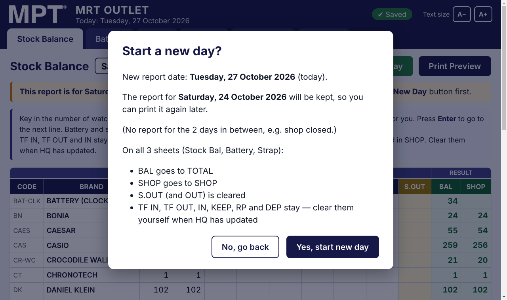
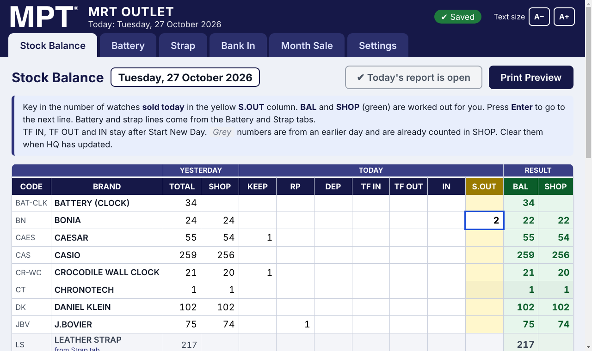
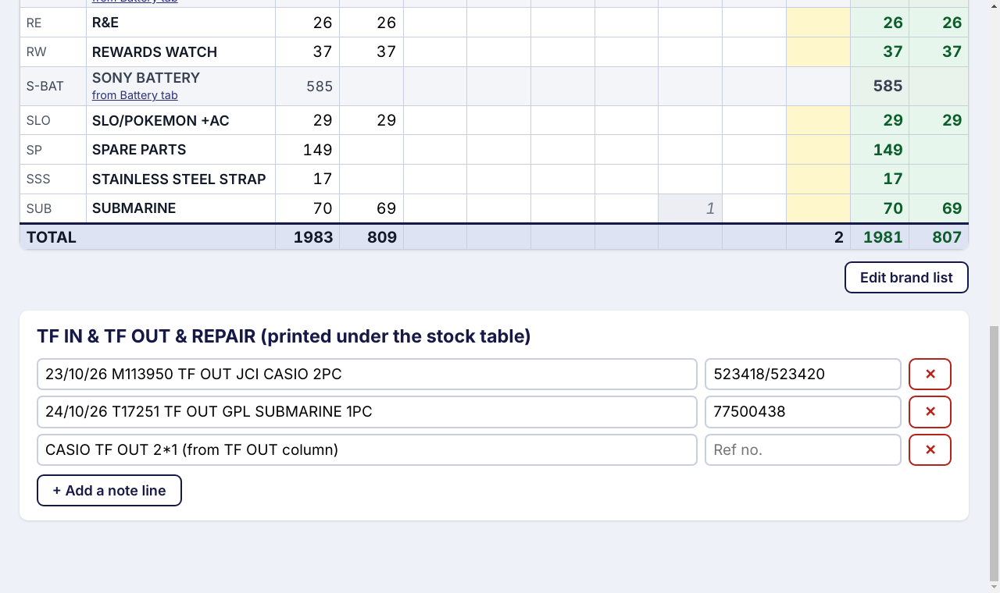
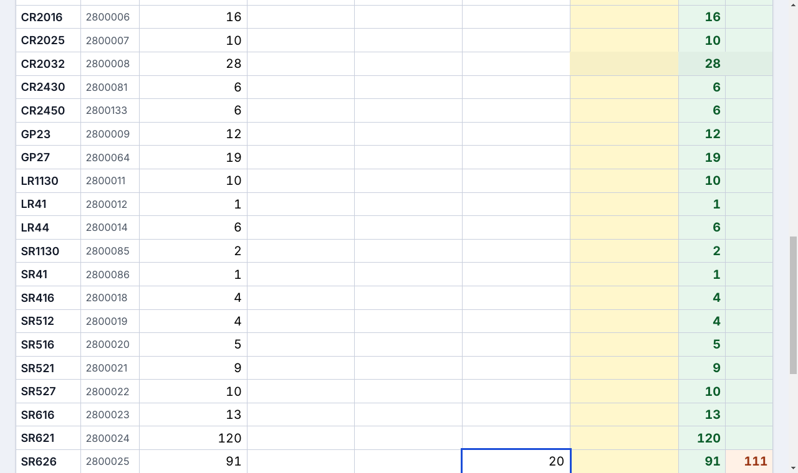
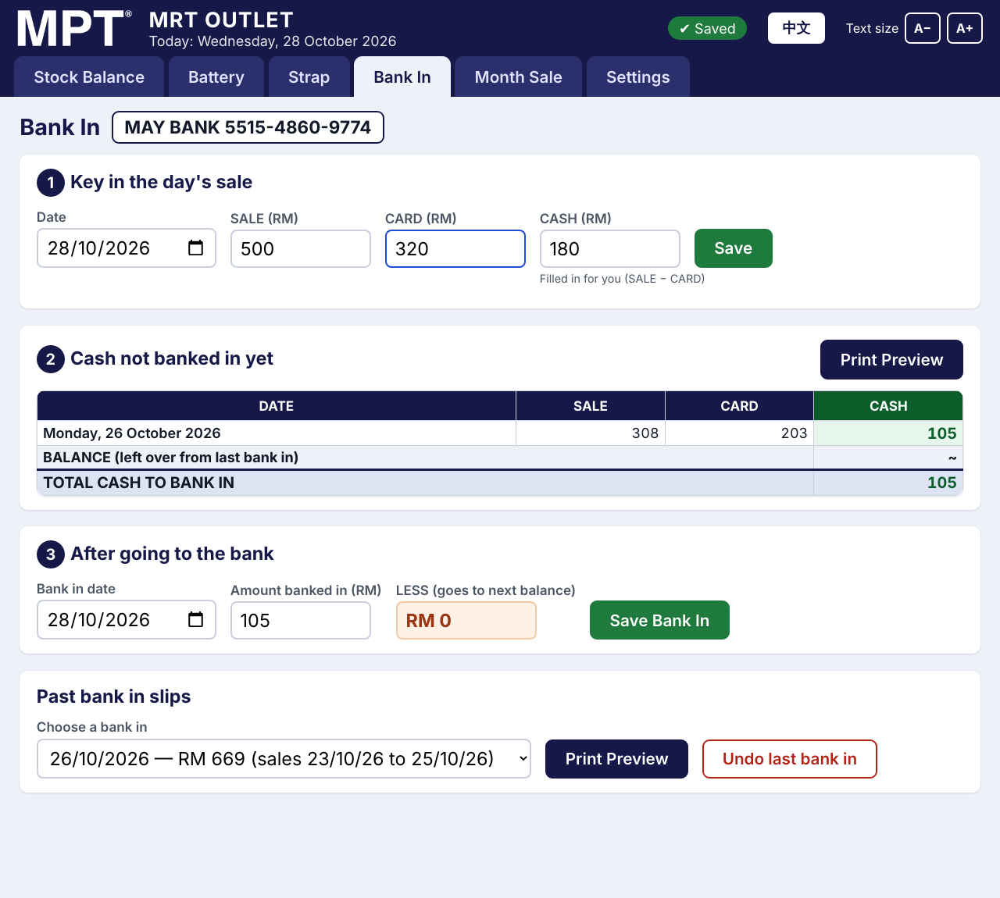
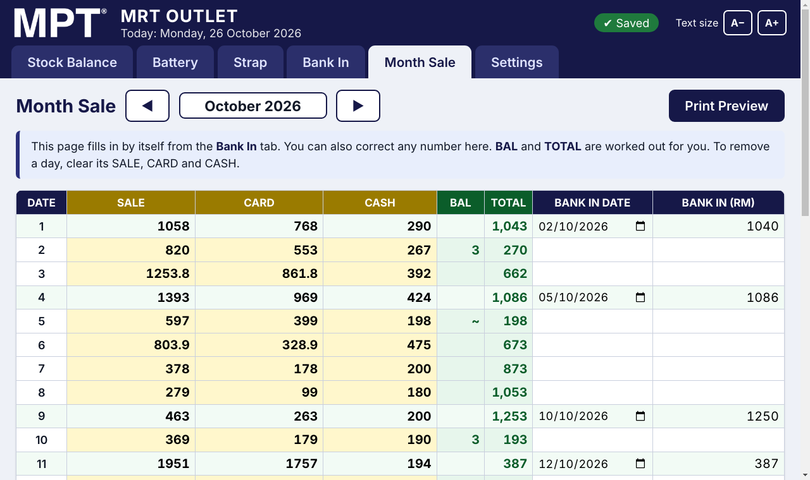
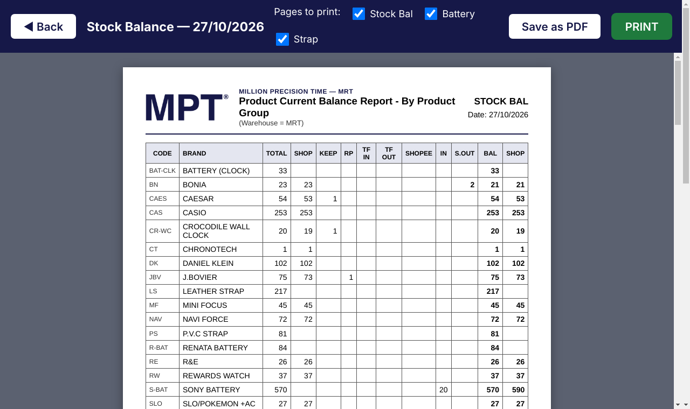
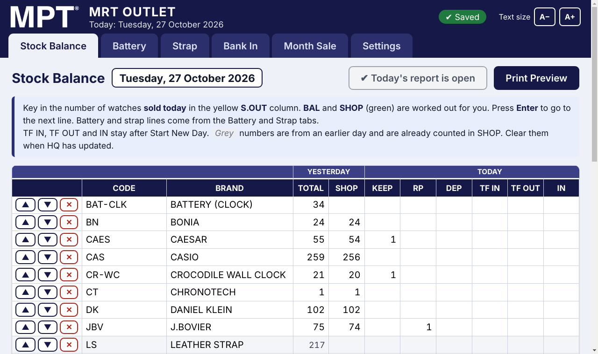
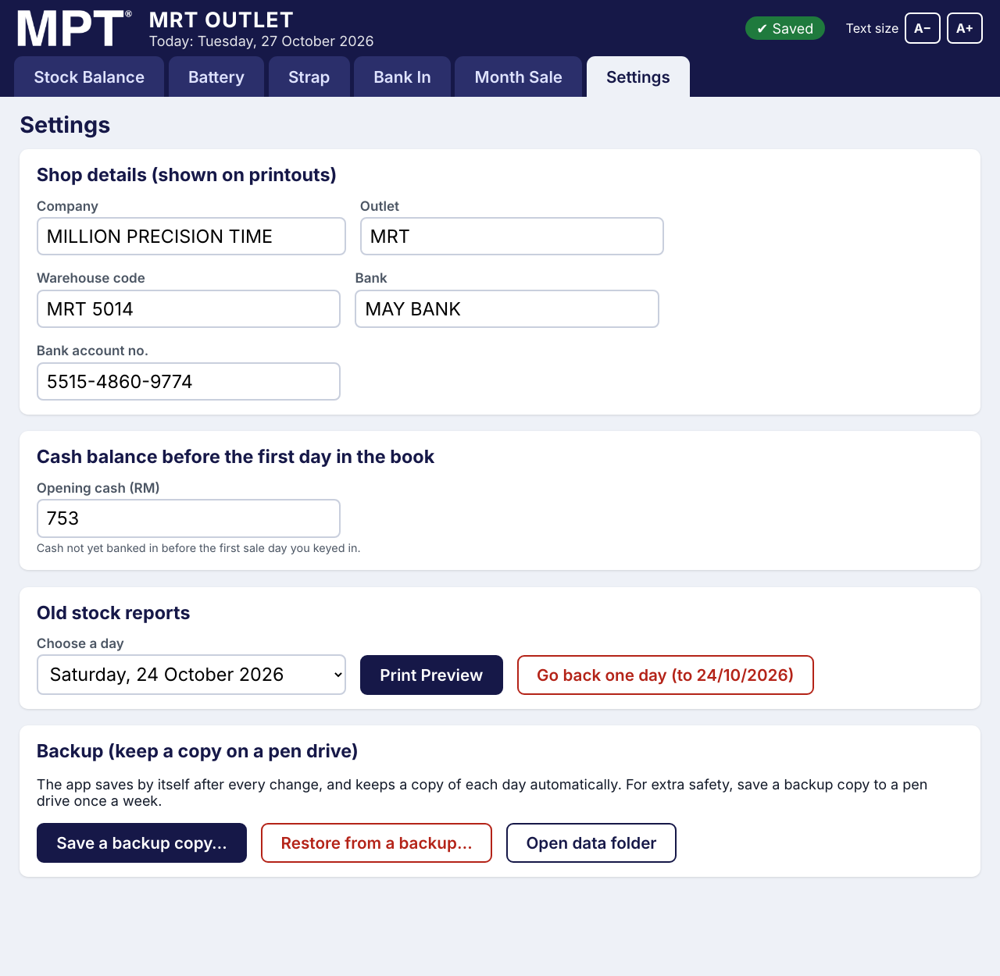

# MRT Daily — User Guide

For the manager of the **MPT MRT outlet**.
This app replaces the Excel files for **Stock Balance**, **Bank In** and **Month Sale**.

You do not need the internet. The app **saves by itself**, so there is no Save button for the stock.

---

## 1. Opening the app

Double-click the **MRT Daily** icon on the desktop.

At the top of the screen you will see:

- **Today's date**, under "MRT OUTLET".
- **✔ Saved** (green), which means everything is safe. If it shows **NOT SAVED!** in red, call for help.
- **A− / A+**, to make the writing smaller or bigger.

Below that are the **tabs**. Click a tab to open that page:

| Tab | What it is for |
|---|---|
| **Stock Balance** | Watches sold today (S.OUT) |
| **Battery** | Batteries sold today |
| **Strap** | Straps sold today |
| **Bank In** | The day's sale, and money banked in |
| **Month Sale** | The whole month in one table |
| **Settings** | Shop details, old reports, backups |

### Colours used on every page

| Colour | Meaning |
|---|---|
| **Yellow** column | Where you type every day |
| **White** box | You can type here when needed |
| **Green** number | Worked out by the app, so you cannot type here |
| **Orange** number | SHOP is different from BAL (stock waiting for HQ) |
| **Red** box | Not a number, so check what you typed |

---

## 2. Every morning: Start New Day

Do this **once every morning**, before keying in anything.

1. Open the **Stock Balance** tab.
2. Press the green **Start New Day** button.
3. The new report date is **always today's date** (taken from the computer). Press **Yes, start new day**.

After that, the button turns grey and reads **✔ Today's report is open**. Pressing it again the same day does nothing, so the date can never jump ahead.

> If the shop was closed for a few days, that's fine. Start New Day goes straight to today.

The app now does what you used to do by copy and paste, on all 3 sheets (Stock Bal, Battery, Strap):

- BAL goes to TOTAL
- SHOP goes to SHOP
- **S.OUT** (and OUT on Battery / Strap) is cleared
- **TF IN, TF OUT, IN, KEEP, RP and DEP stay.** Clear them yourself when HQ has updated (see section 3).

Yesterday's report is kept, so you can print it again later (see section 9).

> If you forget, a **yellow note** at the top reminds you that the report is for an earlier day.
>
>
> **To go back a day** (for example, you forgot to key in yesterday's sales), go to **Settings → Go back one day**.
> The button shows the date it goes back to, and you can press it again to go back further.
> Anything typed on the newer day is lost, so do this before keying in today's numbers.
>
> If the report date is ever **later than today** (for example the computer's clock was wrong), a yellow note
> appears with a **Go back one day** button. Press it until the report shows the right day.

---

## 3. Watches sold: Stock Balance tab

1. Find the brand.
2. Click the **yellow S.OUT** box on that line.
3. Type the **number of watches sold** (the quantity, not the price).
4. Press **Enter** to go down to the next brand.

**BAL** and **SHOP** (green) change straight away, and so does the **TOTAL** line at the bottom.

### The other columns

| Column | What to type |
|---|---|
| TOTAL / SHOP (yesterday) | Filled in by Start New Day. Change only when HQ gives a new number. |
| KEEP / RP / DEP | Watches on keep, in repair, on deposit. They stay from day to day. |
| TF IN | Watches transferred **in** from another outlet |
| TF OUT | Watches transferred **out** to another outlet |
| IN | New stock that arrived |

### TF IN, TF OUT and IN stay until you clear them

Start New Day does **not** clear TF IN, TF OUT and IN. They stay on the sheet, like a reminder, until HQ updates.

- On the day you type it, the number changes **SHOP**.
- On the next days the number is shown in **grey**. Grey means it is already counted, so SHOP does not change again.
- When HQ has updated: type the HQ number in **TOTAL**, then **clear** the grey number. SHOP stays the same.
- If more go out on another day, type the new total in the same box (for example 1 → 3). Only the 2 new ones change SHOP.

**The rule the app uses:**

- BAL = TOTAL − S.OUT
- SHOP = yesterday's SHOP + TF IN − TF OUT + IN − S.OUT (TF IN / TF OUT / IN only on the day they are typed)

The grey lines (**LEATHER STRAP, P.V.C STRAP, RENATA BATTERY, SONY BATTERY**) cannot be typed into here. They add up by themselves from the **Battery** and **Strap** tabs.

### Notes: TF IN & TF OUT & REPAIR

Scroll to the bottom of the Stock Balance page. Write each transfer or repair on its own line, with the reference number on the right. These lines are printed under the stock table.

- **+ Add a note line** adds a new line.
- The red **✕** removes a line.

---

## 4. Batteries and straps: Battery and Strap tabs

1. Open the **Battery** (or **Strap**) tab.
2. Type the number sold in the **yellow OUT** column.
3. Press **Enter** to go down.

### New stock came, but HQ has not updated yet

Example: 20 pieces of SR626 arrived, and HQ still shows 100.

1. Type **20** in the **IN** box of SR626.
2. **SHOP** becomes **120** (orange) and **BAL** stays at **100**.
3. You don't need to do anything else. On the next days, IN = 20 stays in **grey** and SHOP stays 120.
4. When HQ updates the stock, change **TOTAL** to the HQ number (**120**) and clear **IN**.

---

## 5. Daily sale and bank in: Bank In tab

### Step 1: Key in the day's sale (every day)

1. Check the **Date**.
2. Type the **SALE** amount.
3. Type the **CARD** amount.
4. **CASH** is filled in for you (SALE − CARD). You can change it if needed.
5. Press **Save**.

To fix a day you already saved, choose that date again. The numbers come back, so change them and press **Update this day**.

### Step 2: Cash not banked in yet

This table shows every day since the last bank in:

- **BALANCE** is the money left over from the last bank in (the "less").
- **TOTAL CASH TO BANK IN** is all of it added together.

Press **Print Preview** if you want to print it before going to the bank.

### Step 3: After going to the bank

1. Check the **Bank in date**.
2. Type the **amount you banked in**.
3. **LESS** shows what is left over, and it goes to the next balance by itself.
   Example: total 750, banked in 700, so LESS = 50.
4. Press **Save Bank In**, then **Yes, save**.
5. The app asks if you want to print the slip. Press **Yes, print preview**.

### Old bank in slips

At the bottom of the page, choose a past bank in and press **Print Preview**.
If the last bank in was wrong, press **Undo last bank in** and do Step 3 again.

---

## 6. Month Sale tab

This page **fills in by itself** from the Bank In tab. You do not need to type here.

- Use **◀ ▶** to change the month.
- Today's line has a **blue border**.
- Days that were banked in are shown in **light green**.
- You can correct any SALE, CARD, CASH, BANK IN DATE or BANK IN number. BAL and TOTAL update by themselves.
- To remove a day, clear its SALE, CARD and CASH.

---

## 7. Printing

On any page, press **Print Preview**. You will see the paper exactly as it will be printed.

- **PRINT** (green) sends it to the printer. Choose the printer, then press Print.
- **Save as PDF** saves a file (on the Desktop, unless you choose another place).
- **◀ Back** (or the Esc key) goes back without printing.
- For the stock report, tick or untick **Stock Bal / Battery / Strap** to choose which pages to print.

| Report | Where |
|---|---|
| Stock balance (3 pages) | Stock Balance, Battery or Strap tab |
| Bank in slip | Bank In tab |
| Month sale | Month Sale tab |
| Old stock report | Settings → Old stock reports |

Shortcut: **Ctrl + P** on the stock pages opens the print preview.

---

## 8. Adding, renaming or removing brands and items

### Brands (Stock Balance tab)

1. Press **Edit brand list** (under the table).
2. You can now:
   - press **+ Add a brand**, then type the code, name and quantity now;
   - type a new **code** or **name** straight into the box;
   - press **▲ ▼** to move a line up or down (this is also the order on paper);
   - press the red **✕** to remove a brand (the app asks first).
3. Press **Finish editing brand list**.

### Batteries and straps (Battery / Strap tab)

Press **Edit list (add / remove items)**. You can add, rename, move or remove items, and add a whole new group (for example a new battery brand). A new group also appears as one line on the Stock Balance sheet.

> Removing a brand only affects today and later days. Old reports still show it.

---

## 9. Settings tab

- **Shop details**: company, outlet, bank name and account number, as printed on the reports.
- **Opening cash**: the cash balance before the first day in the book. Set this once only.
- **Old stock reports**: choose a day and press **Print Preview**.
- **Go back one day (to …)**: goes back to the previous report. Use it only for mistakes. Anything typed on the current day is lost.
- **Backup**:
  - **Save a backup copy…**: put a pen drive in and save the file there **once a week**.
  - **Restore from a backup…**: only if the computer was changed or the data is lost.
  - **Open data folder**: shows where the app keeps its file.

The app also keeps a copy **every day by itself** (the last 120 days).

---

## 10. Problems and answers

| Problem | What to do |
|---|---|
| A box turned **red** | You typed something that is not a number. Delete it and type the number again. |
| BAL or SHOP looks wrong | Check TOTAL, S.OUT, TF IN, TF OUT and IN on that line. Did you press Start New Day today? |
| A grey number is still there | It is from an earlier day. Clear it once HQ has updated; SHOP will not change. |
| I pressed Start New Day twice | Nothing happens the second time, so there's nothing to fix. |
| I need to go back to yesterday | Settings → **Go back one day**. |
| The report date is later than today | Press **Go back one day** in the yellow note until it shows the right day. Check the computer's date and time. |
| I saved the wrong bank in | Bank In tab → **Undo last bank in**, then save it again. |
| A day's sale is wrong | Bank In tab, choose the date, fix it, then **Update this day**. Or fix it in Month Sale. |
| The writing is too small | Press **A+** at the top right. |
| The printer did not print | Check the printer is on and has paper, then press **PRINT** again. Or use **Save as PDF** and print the file. |
| **NOT SAVED!** in red | Do not close the app. Call for help. |
| The computer broke | Install MRT Daily on the new computer, then Settings → **Restore from a backup…** and choose the file on the pen drive. |
